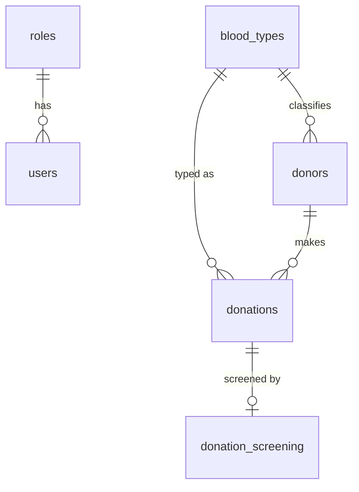

# Blood Donation Management System (Labs 1-10)

Stack: HTML, CSS, JavaScript, Supabase (Postgres). No build step.
 jk jh j jh hj jhbh
## Setup
1. Create a project at supabase.com, open SQL Editor, and run `sql/schema.sql`.
2. Paste your Project URL and anon/publishable key into `js/config.js`.
3. Serve the folder (VS Code Live Server, or `python -m http.server 8000`) and open `index.html`.
4. `git init`, commit, and push to your repository.

## Structure
`index.html` page shell | `css/style.css` styles | `js/config.js` Supabase keys | `js/app.js` all screens | `sql/schema.sql` database

## Conventions
Database: snake_case, plural table names. JavaScript: camelCase. Files: kebab-case. Commit per lab: `lab-05: donor search`.

## ERD (Lab 2)

## Lab map
1 setup + connection test (Home) | 2-3 `schema.sql` | 4-6 Donors | 7 Blood types | 8 blood type on donor + filter | 9 Donations | 10 Screening
